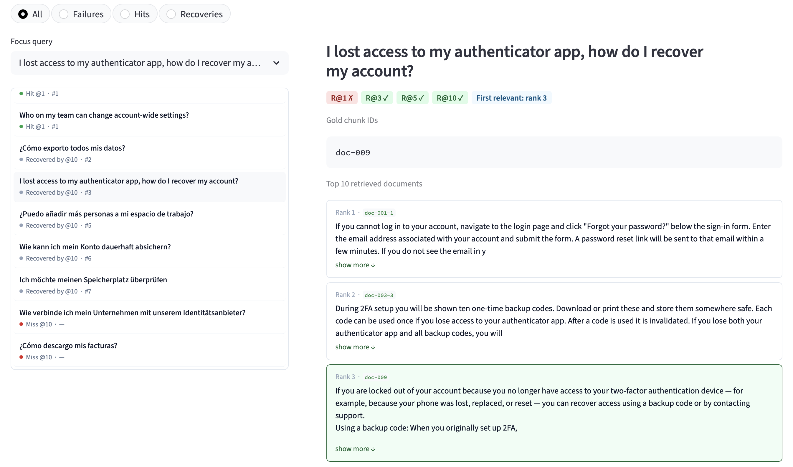

<h1 align="center">retrieval-evaluator</h1>

<p align="center"><b>Evaluate embedding models on the corpus your RAG system actually serves.</b></p>

<p align="center">
  <a href="https://github.com/MaxBelitsky/retrieval-evaluator/actions/workflows/ci.yml"></a>
  <a href="https://pypi.org/project/retrieval-evaluator/"></a>
  <a href="https://pypi.org/project/retrieval-evaluator/"></a>
  <a href="https://github.com/MaxBelitsky/retrieval-evaluator/blob/main/LICENSE"></a>
</p>

<p align="center">
  
</p>

`retrieval-evaluator` is a focused toolkit for comparing retrieval choices on private or domain-specific corpora. It can:

- evaluate HuggingFace, OpenAI, and Cohere embedders against BEIR-format relevance judgments;
- bootstrap a synthetic evaluation set from JSONL, Weaviate, Qdrant, or a custom Python source;
- compare exact semantic retrieval by default, or semantic/BM25/hybrid retrieval with Weaviate; and
- save reproducible run artifacts for per-query inspection in a Streamlit dashboard.

It evaluates retrieval, not answer generation. Synthetic queries are useful for bootstrapping, but they are not a substitute for real user queries and human relevance judgments.

## Quick start

Use Python 3.10 or newer, preferably in a virtual environment. Install the local HuggingFace embedder and dashboard features:

**Before the first PyPI release:** run `pip install ".[hf,dashboard]"` from the repository root, or use the `uv` checkout setup below. The package-name installation commands in this guide require a published release; for an unreleased checkout, replace `retrieval-evaluator[EXTRAS]` with `.[EXTRAS]` when adding features.

```bash
pip install "retrieval-evaluator[hf,dashboard]"
```

Run the bundled multilingual help-center benchmark with an English embedding model:

```bash
retrieval-evaluator eval \
  --collections EXAMPLE \
  --model sentence-transformers/all-MiniLM-L6-v2
```

The first run downloads the model (about 90 MB). A representative result is:

```text
                              embedder collection  alpha   R@1   R@3   R@5  R@10  MRR@10
sentence-transformers/all-MiniLM-L6-v2    EXAMPLE  1.000 0.417 0.583 0.667 0.833   0.529
```

Open the saved rankings and inspect individual hits and misses:

```bash
retrieval-evaluator dashboard
```

In **Inspector**, select **Failures** to examine missed queries. Expand a missing relevant passage to compare what should have been retrieved with the actual results.

The dashboard binds to `127.0.0.1` by default because run artifacts can contain
private corpus text. Use `--host` only when you intentionally want another interface,
and apply appropriate network access controls.



The example deliberately includes German and Spanish queries: the English-only model misses some of them. Compare it with a multilingual embedder to see whether the misses recover.

From a source checkout, the equivalent setup is:

```bash
uv sync --extra hf --extra dashboard
uv run retrieval-evaluator eval --collections EXAMPLE --model sentence-transformers/all-MiniLM-L6-v2
uv run retrieval-evaluator dashboard
```

Contributors should use `uv sync --locked --all-extras --group dev`.

## What the metrics mean

Metrics are macro-averaged over every positively judged query in `qrels.tsv`. A query with no ranking is a miss.

| Metric | Meaning |
|---|---|
| `R@K` | Hit rate: fraction of queries with at least one relevant chunk in the top K. |
| `Recall@K` | Mean fraction of each query's relevant chunks retrieved in the top K. |
| `R_all@K` | Fraction of queries for which all relevant chunks appear in the top K. |
| `MRR@K` | Mean reciprocal rank of the first relevant chunk in the top K. |

With one relevant chunk per query, `R@K` and `Recall@K` are identical. None of these metrics measures answer correctness, faithfulness, latency, or cost.

## Evaluate your own judged data

If you already have queries and relevance labels, use them. The required layout is standard BEIR:

```text
eval_data/
  my-collection/
    corpus.jsonl
    queries.jsonl
    qrels.tsv
```

See the [Bring Your Own Dataset guide](https://github.com/MaxBelitsky/retrieval-evaluator/blob/main/docs/byod.md) for the schema, official split layout, CSV/JSONL conversion, and public BEIR datasets.

Convert existing CSV data:

```bash
retrieval-evaluator import-dataset \
  --format csv \
  --corpus chunks.csv \
  --queries qa.csv \
  --corpus-id-field id \
  --corpus-text-field text \
  --query-id-field id \
  --query-text-field question \
  --relevant-id-field chunk_id \
  --output eval_data/my-collection

retrieval-evaluator eval --collections my-collection \
  --model intfloat/multilingual-e5-base \
  --query-prompt "query: " --passage-prompt "passage: "
```

Importing directly from the Hugging Face Hub requires `pip install "retrieval-evaluator[datasets]"` and `--format hf`.

## Bootstrap a dataset from existing chunks

When judged queries do not exist yet, `build-dataset` can select diverse documents, generate synthetic questions from their chunks, and write a BEIR dataset. All chunks from the selected documents remain retrieval candidates, including chunks whose questions fail or are skipped by `--chunk-limit` (default: 200 questions). The generated corpus is a sampled subset of the source collection. For the default OpenAI flow:

```bash
pip install "retrieval-evaluator[dataset,openai]"
export OPENAI_API_KEY="..."
```

Put one JSON object per line in `raw_data/source_collections/support_docs.jsonl`:

```json
{"chunk_id":"c1","document_id":"doc-1","position":0,"lang":"en","content":"Chunk text."}
```

Validate the source and mapping without making model calls or writing an evaluation dataset:

```bash
retrieval-evaluator build-dataset \
  --collections support_docs \
  --source-type jsonl \
  --jsonl-root raw_data/source_collections \
  --id-field chunk_id \
  --text-field content \
  --doc-id-field document_id \
  --chunk-id-field position \
  --language-field lang \
  --dry-run
```

For remote Qdrant or Weaviate sources, validation may populate the configured local
source cache even in `--dry-run` mode.

Then run the build:

```bash
retrieval-evaluator build-dataset \
  --collections support_docs \
  --output-dir eval_data \
  --source-type jsonl \
  --jsonl-root raw_data/source_collections \
  --id-field chunk_id \
  --text-field content \
  --doc-id-field document_id \
  --chunk-id-field position \
  --language-field lang \
  --llm-model openai:gpt-4o
```

The source chunk is recorded as relevant to its generated question. Review generated questions before treating scores as a decision gate: synthetic language can preserve lexical clues, miss realistic ambiguity, and overstate production quality. Add real queries and additional judgments as soon as they are available.

Passage text is sent to the configured LLM during query generation. OpenAI and Cohere embedding providers also receive the text they embed; HuggingFace embedding runs locally.

### Data handling

Evaluation stores each passage's full text and metadata in plaintext under
`run_details/<run-id>/corpus_meta.jsonl`. Generated BEIR datasets likewise contain
corpus text under the configured evaluation dataset directory. Qdrant and Weaviate
source checks and dataset builds may cache full exported source payloads under
`settings.raw_chunks_cache_dir` (default: `raw_data/`); those caches remain until you
delete them. Protect these directories with the same access and retention controls as
the source corpus. The default paths are excluded by this repository's `.gitignore`.

### Other chunk sources

The same pipeline supports:

- `weaviate`: reads a remote/source collection; install `[weaviate]`;
- `qdrant`: scrolls point payloads; install `[qdrant]`;
- `jsonl`: reads local files and has no connector dependency; and
- `callable`: imports your function, class, or object for any other store.

Run `retrieval-evaluator init`, edit `config/retrieval-evaluator.yaml`, then use `retrieval-evaluator check-source --collections NAME` before an expensive build. The full schema is in the [annotated config reference](https://github.com/MaxBelitsky/retrieval-evaluator/blob/main/config/retrieval-evaluator.example.yaml).

## Retrieval backends

`numpy` is the default backend. It performs deterministic, exact cosine ranking in-process with no service or native vector-search dependency. It keeps the corpus matrix in memory and does `O(corpus_size × embedding_dimensions)` work per query, so it is intended for modest evaluation collections.

Weaviate is opt-in for BM25 and hybrid experiments:

```bash
pip install "retrieval-evaluator[weaviate]"
retrieval-evaluator eval \
  --collections my-collection \
  --model intfloat/multilingual-e5-base \
  --query-prompt "query: " --passage-prompt "passage: " \
  --index-backend weaviate \
  --alpha 1.0 0.5 0.0
```

Evaluation starts a temporary embedded Weaviate instance and removes its data after each run. Embedded Weaviate supports Linux and macOS; its first use downloads and caches a platform binary. The `database.weaviate` connection block is for exporting source chunks during dataset generation, not for evaluation indexing.

At `alpha=0.0`, evaluation uses Weaviate's BM25 query directly and skips passage
and query embedding requests. Hybrid runs (`0.0 < alpha < 1.0`) score lexical
matches only against passage content, never chunk identifiers.

## Embedder configuration

For repeatable multi-model comparisons, define embedders in `config/embedders.yml`:

```yaml
multilingual-e5-base:
  provider: hf
  model: intfloat/multilingual-e5-base
  max_tokens: 512
  query_prompt: "query: "
  passage_prompt: "passage: "
  precision: float32
```

Then run:

```bash
retrieval-evaluator eval --collections my-collection
retrieval-evaluator eval --collections my-collection --embedders multilingual-e5-base
```

`max_tokens` is enforced against the local model's supported context length. If it exceeds the configured micro-chunk size, adjacent chunks from the same document can be merged while relevance is still scored against their original micro-chunk IDs. Use `--batch-size auto` to probe a safe GPU/MPS batch size.

Run IDs include the current dataset fingerprint, effective embedder settings, alpha, K values, backend, qrels split, and chunk-merging setting. An identical logical run is skipped; `--force-rerun` replaces its result row and artifacts.

## Python API

```python
from retrieval_evaluator import evaluate

results = evaluate(
    collections=["EXAMPLE"],
    embedder_configs={
        "minilm": {
            "provider": "hf",
            "model": "sentence-transformers/all-MiniLM-L6-v2",
            "max_tokens": 256,
        },
        "e5": {
            "provider": "hf",
            "model": "intfloat/multilingual-e5-base",
            "max_tokens": 512,
            "query_prompt": "query: ",
            "passage_prompt": "passage: ",
        },
    },
    index_backend="numpy",
    artifacts_dir="run_details/api-example",
)

print(results[["embedder", "collection", "R@1", "R@5", "MRR@10"]])
results.to_csv("run_details/api-example/results.csv", index=False)
```

To inspect this saved API run, install `[dashboard]` and launch:

```bash
retrieval-evaluator dashboard \
  --results-file run_details/api-example/results.csv \
  --artifacts-dir run_details/api-example
```

For your own datasets, also pass `--dataset-dir` with the dataset root used by `evaluate()`.
The API returns the results table; saving it explicitly makes it available to the dashboard.

`build_dataset()` provides the in-memory counterpart to `build-dataset`. See the runnable [programmatic API example](https://github.com/MaxBelitsky/retrieval-evaluator/blob/main/examples/05_programmatic_api.py).

## Optional features

The base install contains dataset I/O, metrics, the NumPy backend, CLI scaffolding, and the Python API. Install only the features you use:

| Extra | Capability |
|---|---|
| `hf` | Local HuggingFace/sentence-transformers embeddings |
| `openai` | OpenAI embeddings and OpenAI LangChain adapter |
| `cohere` | Cohere embeddings |
| `dashboard` | Streamlit results dashboard |
| `dataset` | K-means document selection and LangChain dataset-generation pipeline |
| `anthropic` | Anthropic LangChain adapter; combine with `dataset` |
| `weaviate` | Weaviate source connector and embedded hybrid evaluation backend |
| `qdrant` | Qdrant source connector |
| `datasets` | Hugging Face dataset import (`import-dataset --format hf`) |
| `all` | Every optional feature |

Examples: `pip install "retrieval-evaluator[openai,dashboard]"` or `pip install "retrieval-evaluator[dataset,anthropic]"`.

## Runnable examples

| Script | Purpose | Requirements |
|---|---|---|
| [01_quickstart.py](https://github.com/MaxBelitsky/retrieval-evaluator/blob/main/examples/01_quickstart.py) | Bundled benchmark with one local embedder | `[hf]` |
| [02_eval_local_jsonl.py](https://github.com/MaxBelitsky/retrieval-evaluator/blob/main/examples/02_eval_local_jsonl.py) | JSONL chunks → synthetic dataset → evaluation | `[dataset,openai]`, `OPENAI_API_KEY` |
| [03_custom_source.py](https://github.com/MaxBelitsky/retrieval-evaluator/blob/main/examples/03_custom_source.py) | Custom callable source contract | base install |
| [05_programmatic_api.py](https://github.com/MaxBelitsky/retrieval-evaluator/blob/main/examples/05_programmatic_api.py) | Multi-model Python API | `[hf]` |
| [06_ci_integration.py](https://github.com/MaxBelitsky/retrieval-evaluator/blob/main/examples/06_ci_integration.py) | Fail-closed retrieval quality gate | chosen provider extra; `[weaviate]` for that backend |

Run examples from the repository root with `uv run python examples/01_quickstart.py`.

## Configuration and outputs

The quick start needs no config file. `retrieval-evaluator init` creates two files:

- `config/retrieval-evaluator.yaml`: dataset/source settings, output paths, and retrieval defaults.
- `config/embedders.yml`: named embedding models, used when `eval` is run without `--model`. Its location is set by `settings.embedders_config_path` in the main config.

`--config` selects the main config file, not the embedder definitions. For example:

```bash
retrieval-evaluator eval --config config/retrieval-evaluator.yaml \
  --collections EXAMPLE --embedders all-MiniLM-L6-v2
```

Use `retrieval-evaluator init --global` for `~/.config/retrieval-evaluator/`. The search order is:

1. `--config PATH` (or `RETRIEVAL_EVALUATOR_CONFIG`);
2. `config/retrieval-evaluator.yaml`;
3. `~/.config/retrieval-evaluator/retrieval-evaluator.yaml`; and
4. `/etc/retrieval-evaluator/retrieval-evaluator.yaml`.

The first matching file is merged with built-in defaults. Relative paths in the config and CLI are relative to the directory you run the command from, **not the config file's directory**. Run project commands from the project root, or use absolute paths when invoking them elsewhere; parent directories are not searched. `--config` takes precedence over the environment variable.

Before evaluation starts, the CLI prints the selected config and absolute dataset, results, and artifact paths. It labels the bundled example data explicitly when used.

Evaluation uses the bundled `EXAMPLE` data when the default `eval_data/` directory does not exist. An explicit `--dataset-dir` must exist. Dataset generation always writes to `settings.evaluation_dataset_dir` (default: `eval_data/`) or `--output-dir`, never into the installed package.

CLI evaluation appends one row per logical run to `eval_runs.csv`; that row includes the dataset fingerprint. Rankings, query snapshots, qrels, and each passage's full text and metadata are stored under `run_details/<run-id>/`. The dashboard uses the fingerprint and snapshots to flag runs whose source dataset has changed.

Every command supports `--help`. The [architecture guide](https://github.com/MaxBelitsky/retrieval-evaluator/blob/main/docs/architecture.md) documents extension points for chunk sources, retrieval backends, and metrics.

## Contributing and security

See [CONTRIBUTING.md](https://github.com/MaxBelitsky/retrieval-evaluator/blob/main/CONTRIBUTING.md) for development setup. Please report vulnerabilities privately using the process in [SECURITY.md](https://github.com/MaxBelitsky/retrieval-evaluator/blob/main/SECURITY.md). User-facing changes are recorded in [CHANGELOG.md](https://github.com/MaxBelitsky/retrieval-evaluator/blob/main/CHANGELOG.md).

## License

[MIT](https://github.com/MaxBelitsky/retrieval-evaluator/blob/main/LICENSE)
